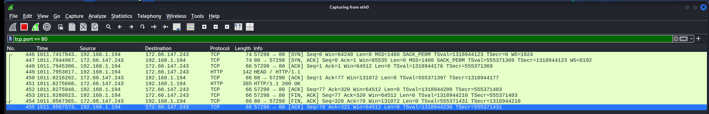

# Catching the TCP handshake with Wireshark

I used Wireshark on my Kali VM to capture the traffic from `curl -I http://example.com`. I used the filter `tcp.port == 80` to show only traffic on port 80.

## What I saw
- **Lines 446, 447, 448:** the TCP three-way handshake: [SYN], [SYN, ACK], [ACK].
- **Line 449:** the HTTP request (`HEAD / HTTP/1.1`).
- **Line 451:** the reply, `HTTP/1.1 200 OK`. Status code 200 means success.
- **Lines 453 to 455:** [FIN] packets, which mean "I'm finished". Both sides close the connection politely.

## What I learned
I could read the HTTP request in plain text because port 80 is not encrypted. This is why HTTPS (port 443) matters.

## Why this matters for security
Analysts use Wireshark to see every tiny piece of data entering and leaving a computer, so they can understand what is really happening on a network.

